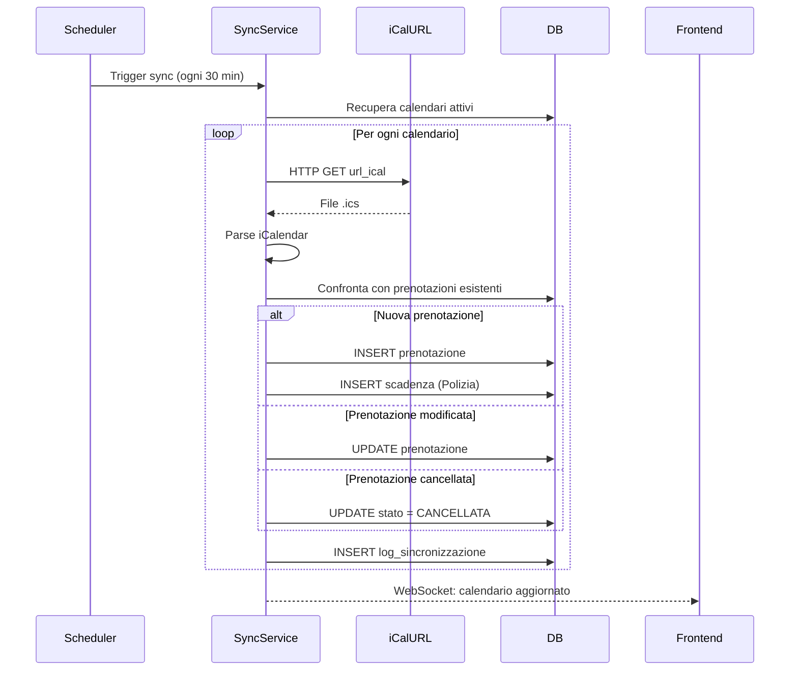
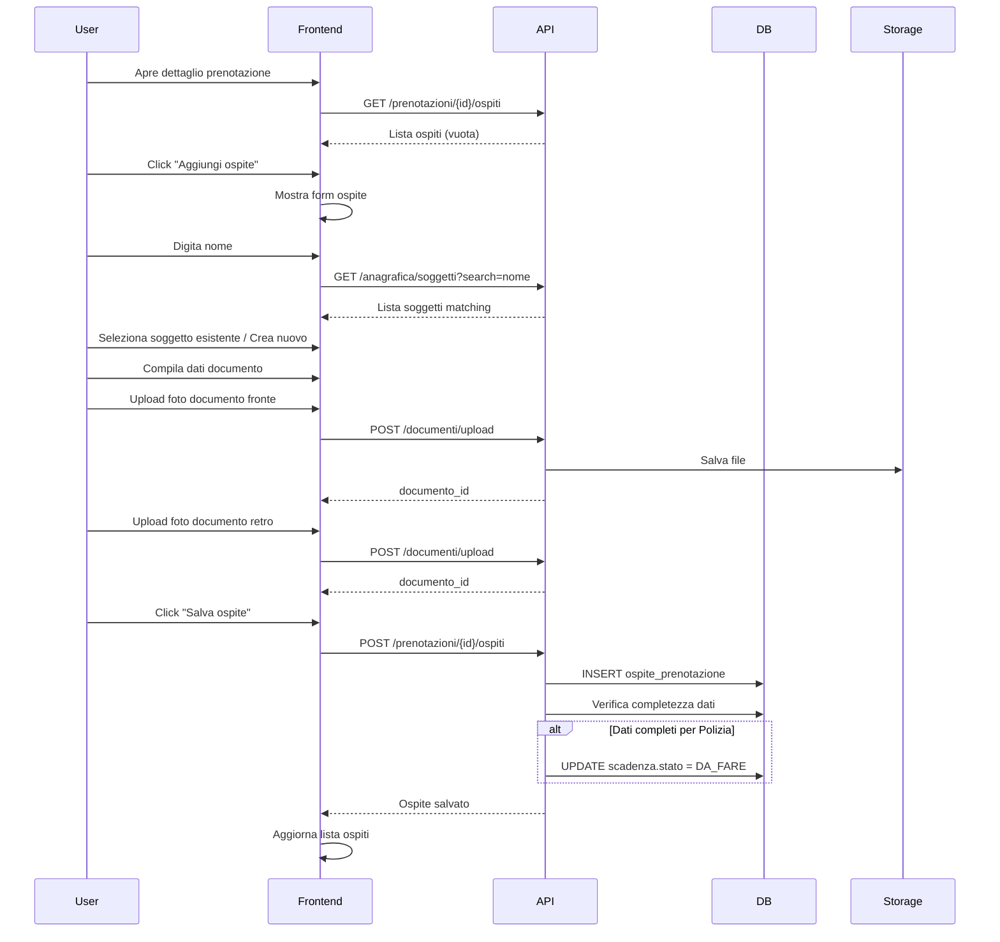
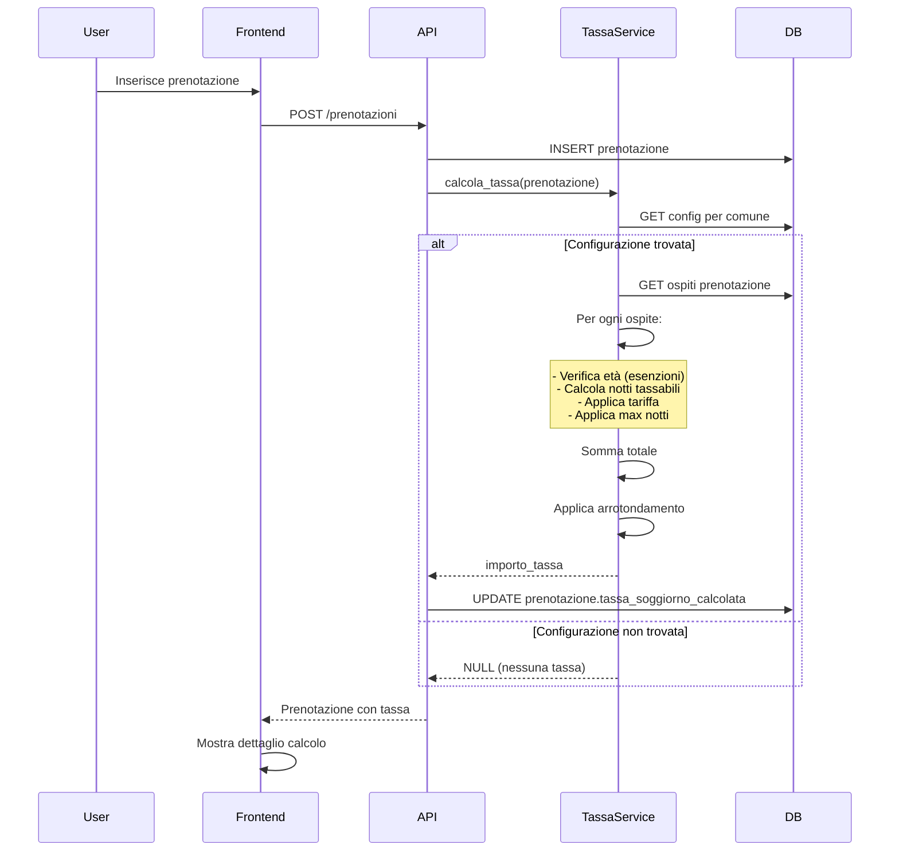
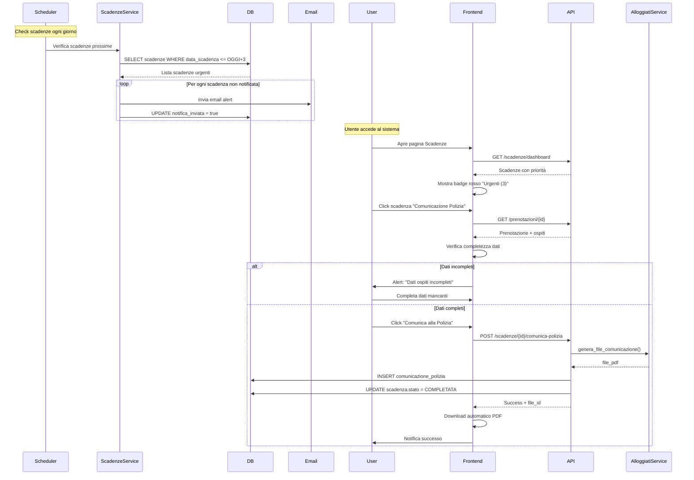

# Analisi Funzionale: Modulo Affitti Brevi

**Versione:** 1.2
**Data:** 28 Dicembre 2025
**Autore:** Gestione Affitti Team

**Changelog:**
- **v1.2:** Calendario multi-piattaforma con vista unificata, gestione conflitti, blocchi calendario
- **v1.1:** Integrazione prezzi portali, filtro immobili affitti brevi, link esterni piattaforme

---

## 1. Panoramica del Modulo

### 1.1 Scopo
Il modulo **affitti_brevi** fornisce una soluzione completa per la gestione di affitti turistici a breve termine, con particolare focus su:
- Sincronizzazione dei calendari dai portali di prenotazione (Booking.com, Airbnb, Vrbo, ecc.)
- Gestione degli ospiti con anagrafica completa e documenti
- Adempimenti normativi italiani (comunicazioni Polizia di Stato, ISTAT)
- Calcolo automatico delle tasse di soggiorno

### 1.2 Dipendenze
Il modulo si integra con i seguenti moduli esistenti:
- **anagrafica_italiana**: Per la gestione degli ospiti (SoggettoAnagrafico)
- **immobili**: Per le unità immobiliari affittate

### 1.3 Utenti Destinatari
- Property Manager di affitti turistici
- Amministratori di immobili turistici
- Addetti alla contabilità e agli adempimenti fiscali

---

## 2. Requisiti Funzionali

### RF-1: Sincronizzazione Calendari (iCal)

**Descrizione:** Il sistema deve importare e visualizzare le prenotazioni da calendari condivisi dei principali portali di prenotazione.

**Dettagli:**
- **Formato supportato:** iCalendar (RFC 5545) - formato .ics
- **Portali supportati:** Booking.com, Airbnb, Vrbo, Expedia, e qualsiasi servizio che esponga URL iCal
- **Frequenza sincronizzazione:** Automatica ogni 30 minuti + on-demand
- **Dati estratti dal calendario:**
  - Data inizio e fine prenotazione
  - Nome ospite (se presente)
  - Codice prenotazione
  - Numero di ospiti (se presente)
  - Importo totale (se presente)
  - Note/descrizione

**Funzionalità:**
1. Configurazione URL iCal per ogni appartamento
2. **Link diretto alla dashboard del portale** (es. admin.booking.com) per accesso rapido
3. Import automatico delle prenotazioni
4. **Parsing intelligente prezzi** dal campo DESCRIPTION (best-effort con fallback manuale)
5. Mappatura automatica prenotazioni → unità immobiliare
6. Gestione conflitti (prenotazioni sovrapposte)
7. Log sincronizzazioni (successo/errore)

**Vincoli tecnici:**
- Gestione eventi ricorrenti
- Parsing robusto di formati iCal non standard
- Timeout configurabile per URL esterni
- Cache per ridurre chiamate esterne
- Pattern configurabili per estrazione prezzi per portale

**Note sull'integrazione prezzi:**
Le API dirette di Booking.com e Airbnb **non sono accessibili** (richiedono partnership formali chiuse a nuove registrazioni). La soluzione implementa:
- **Parsing automatico** dei prezzi dal campo DESCRIPTION dell'iCal (formato varia per portale)
- **Link esterni** alla dashboard del portale per consultazione/modifica prezzi
- **Campo prezzo manuale** con possibilità di override per calcoli tasse e ritenute

---

### RF-2: Gestione Prenotazioni e Ospiti

**Descrizione:** Per ogni prenotazione sincronizzata o manuale, il sistema deve permettere di gestire gli ospiti con anagrafica completa.

**Entità coinvolte:**
- **Prenotazione:**
  - Unità immobiliare (FK → immobili.UnitaImmobiliare)
  - Data check-in / check-out
  - Portale di origine (Booking, Airbnb, Manuale, ecc.)
  - Codice prenotazione portale
  - Stato (Confermata, Check-in effettuato, Check-out effettuato, Cancellata)
  - Importo totale
  - Caparra
  - Note

- **OspitePrenotazione** (tabella di associazione):
  - Prenotazione (FK)
  - Soggetto (FK → anagrafica_italiana.SoggettoAnagrafico)
  - Tipo ospite (Titolare, Accompagnatore, Minore)
  - Età (per statistiche ISTAT)
  - Nazionalità
  - Data nascita
  - Città di residenza
  - Documento identità:
    - Tipo (Carta identità, Passaporto, Patente)
    - Numero
    - Data rilascio
    - Data scadenza
    - Ente rilascio
    - File scansione (FK → Documento)

**Funzionalità:**
1. Aggiunta manuale prenotazioni
2. Associazione ospiti a prenotazione (1:N)
3. Creazione rapida nuovi soggetti dall'interfaccia prenotazione
4. Upload documenti identità (fronte/retro)
5. Validazione documenti (scadenza, completezza dati)
6. Storico ospiti per pre-compilazione dati

**Regole business:**
- Almeno un ospite "Titolare" per prenotazione
- Documenti obbligatori solo per ospiti > 14 anni
- Dati completi richiesti per comunicazione Polizia

---

### RF-3: Scadenziario Adempimenti

**Descrizione:** Sistema di notifiche e scadenze per gli adempimenti normativi obbligatori.

**Scadenze gestite:**

#### 3.1 Comunicazione Polizia di Stato (Alloggiati Web)
- **Normativa:** Art. 109 TULPS
- **Scadenza:** Entro 24 ore dall'arrivo ospiti
- **Dati richiesti:**
  - Tutti i dati anagrafici ospiti
  - Documenti identità validi
  - Date soggiorno
  - Indirizzo immobile
- **Stati:**
  - Da inviare
  - Inviata (data/ora invio, utente)
  - Inviata in ritardo (flag alert)
  - Errore (log errore, riprova automatica)

#### 3.2 Tassa di Soggiorno
- **Scadenza:** Variabile per comune (es. trimestrale, mensile)
- **Calcolo automatico:** Vedi sezione RF-4
- **Stati:**
  - Da versare
  - Versata (data versamento, importo, riferimento)
  - Scaduta

#### 3.3 Statistiche ISTAT
- **Normativa:** Rilevazione movimento clienti strutture ricettive
- **Scadenza:** Mensile (entro 5° giorno del mese successivo)
- **Dati aggregati:**
  - Arrivi per nazionalità
  - Presenze (notti) per nazionalità
  - Tipologia clientela (Italia/Estero)
- **Stati:**
  - Da compilare
  - Compilata
  - Inviata (data invio)

**Funzionalità scadenziario:**
- Dashboard scadenze con semaforo (verde/giallo/rosso)
- Notifiche email/push automatiche
- Filtri per tipo scadenza, stato, periodo
- Esportazione report scadenze (PDF, Excel)
- Configurazione soglie alert (es. 3 giorni prima)

---

### RF-4: Calcolo Automatico Tassa di Soggiorno

**Descrizione:** Calcolo preciso e automatico delle tasse di soggiorno secondo le normative comunali.

**Parametri configurabili per comune:**
- **Importo per notte/persona:**
  - Fisso (es. €2,50/notte)
  - Percentuale sul prezzo (es. 5% fino a max €5/notte)
  - Scaglioni per tipologia immobile (es. Casa vacanze €3, B&B €2)
- **Esenzioni:**
  - Bambini sotto X anni (es. < 12 anni)
  - Persone con disabilità
  - Accompagnatori/assistenti
  - Prima/seconda notte gratuita
- **Numero massimo notti:** Oltre X notti, tassa non applicata (es. max 5 notti)
- **Periodo applicazione:** Date inizio/fine validità tariffa
- **Arrotondamento:** Regole arrotondamento (centesimi, 0.50€, ecc.)

**Formula calcolo:**
```
TassaTotale = Σ (per ogni ospite) [
  ImportoPerNotte × Min(NumeroNottiSoggiorno, MaxNottiTassabili) × (1 - Esenzione)
]
```

**Funzionalità:**
1. Configurazione tariffe per comune
2. Calcolo automatico all'inserimento prenotazione
3. Ricalcolo automatico se modificati parametri
4. Override manuale importo (con motivazione)
5. Report tasse per periodo (riepilogo per comune)
6. Generazione file per versamento (CBI, MAV, F24)
7. Storico variazioni tariffe

**Esempio pratico 1 - Importo fisso:**
- **Prenotazione:** Firenze, 3 notti, 2 adulti + 1 bambino 8 anni
- **Tariffa Firenze:** €5/notte/persona, esenzione < 12 anni, max 7 notti
- **Calcolo:**
  - Adulto 1: €5 × 3 notti = €15
  - Adulto 2: €5 × 3 notti = €15
  - Bambino: €0 (esente)
  - **Totale: €30**

**Esempio pratico 2 - Percentuale sul prezzo (NUOVO v1.1):**
- **Prenotazione:** Roma, 3 notti, 2 adulti + 1 bambino 10 anni, importo totale €450
- **Tariffa Roma:** 5% del prezzo per persona/notte, max €5/notte, bambini < 12 anni esenti
- **Calcolo:**
  - Prezzo per notte: €450 / 3 notti = €150
  - Prezzo per persona/notte: €150 / 3 ospiti = €50
  - Adulto 1: €50 × 5% = €2.50 (< max €5) × 3 notti = €7.50
  - Adulto 2: €50 × 5% = €2.50 (< max €5) × 3 notti = €7.50
  - Bambino: €0 (esente)
  - **Totale: €15**

**Nota:** Per il calcolo percentuale, è necessario che il campo `prezzo_per_notte` sia popolato (da parsing iCal o inserimento manuale)

---

### RF-5: Filtro Immobili per Affitti Brevi (NUOVO v1.1)

**Descrizione:** Non tutti gli immobili sono destinati ad affitti brevi. Il sistema deve permettere di identificare e filtrare quali unità immobiliari sono gestite per turismo breve.

**Soluzione implementata:**
Aggiunta del campo `destinazione_uso` al modello `UnitaImmobiliare` del modulo `immobili`:

```python
class DestinazioneUso(str, Enum):
    RESIDENZIALE = "RESIDENZIALE"       # Abitazione proprietario
    AFFITTO_BREVE = "AFFITTO_BREVE"     # Turismo < 30 giorni
    AFFITTO_LUNGO = "AFFITTO_LUNGO"     # Contratti > 30 giorni
    COMMERCIALE = "COMMERCIALE"         # Negozi, uffici
    MAGAZZINO = "MAGAZZINO"             # Box, cantine
    MISTO = "MISTO"                     # Uso promiscuo
```

**Funzionalità:**
1. **Toggle attivazione modulo** nella scheda immobile
2. **Filtro automatico** nei dropdown del modulo affitti_brevi (solo immobili con `destinazione_uso = AFFITTO_BREVE`)
3. **Query API** filtrate: `GET /immobili/unita-immobiliari/?destinazione_uso=AFFITTO_BREVE`
4. **Configurazione iniziale** tramite endpoint dedicato

**Endpoint attivazione:**
```
POST /api/v1/immobili/unita-immobiliari/{id}/attiva-modulo
{
  "modulo": "AFFITTI_BREVI",
  "attivo": true
}
```

**Benefici:**
- Separazione netta tra immobili per uso diverso
- Semplifica la navigazione (solo immobili pertinenti visibili)
- Possibilità di uso misto stagionale (es. affitto breve estate, lungo inverno)

---

## 3. Architettura del Modulo

### 3.1 Struttura Directory

```
backend/modules/affitti_brevi/
├── __manifest__.py          # Metadati modulo
├── __init__.py              # Entry point
├── models/                  # Modelli SQLAlchemy
│   ├── __init__.py
│   ├── prenotazione.py
│   ├── ospite_prenotazione.py
│   ├── calendario_ical.py
│   ├── tassa_soggiorno_config.py
│   ├── scadenza.py
│   └── comunicazione_polizia.py
├── schemas/                 # Schemi Pydantic
│   ├── __init__.py
│   ├── prenotazione.py
│   ├── ospite.py
│   ├── tassa.py
│   └── scadenza.py
├── routes/                  # Endpoints API
│   ├── __init__.py
│   ├── prenotazioni.py
│   ├── calendari.py
│   ├── ospiti.py
│   ├── scadenze.py
│   └── tasse.py
├── services/               # Business logic
│   ├── __init__.py
│   ├── ical_sync_service.py      # Sincronizzazione iCal
│   ├── tassa_soggiorno_service.py # Calcolo tasse
│   ├── scadenze_service.py       # Gestione scadenze
│   └── alloggiati_service.py     # Export formato Polizia
└── utils/
    ├── __init__.py
    ├── ical_parser.py       # Parsing iCalendar
    └── validators.py        # Validazioni documenti

frontend/src/modules/affitti_brevi/
├── manifest.js              # Configurazione frontend
├── index.js                 # Export componenti
├── services/
│   └── affittiBreviAPI.js  # Client API
├── components/
│   ├── Prenotazioni/
│   │   ├── PrenotazioniList.jsx
│   │   ├── PrenotazioneForm.jsx
│   │   ├── PrenotazioneCalendar.jsx
│   │   └── OspitiSection.jsx
│   ├── Ospiti/
│   │   ├── OspiteForm.jsx
│   │   ├── DocumentoUpload.jsx
│   │   └── OspitiTable.jsx
│   ├── Calendari/
│   │   ├── CalendariList.jsx
│   │   ├── CalendarioConfigForm.jsx
│   │   └── SyncLog.jsx
│   ├── Scadenze/
│   │   ├── ScadenzeDashboard.jsx
│   │   ├── ScadenzeList.jsx
│   │   └── ComunicazionePoliziaModal.jsx
│   └── Tasse/
│       ├── TasseConfig.jsx
│       ├── TasseReport.jsx
│       └── TasseCalculator.jsx
└── pages/
    ├── PrenotazioniPage.jsx
    ├── CalendariPage.jsx
    ├── ScadenzePage.jsx
    └── TassePage.jsx
```

---

## 4. Modello Dati (Database Schema)

### 4.1 Tabella: calendario_ical

Configurazione URL iCal per sincronizzazione.

```python
class CalendarioICal(Base):
    __tablename__ = "calendario_ical"

    id: int                          # PK
    unita_immobiliare_id: int        # FK → immobili.unita_immobiliari
    portale: str                      # BOOKING, AIRBNB, VRBO, ALTRO
    url_ical: str                     # URL pubblico calendario iCal
    attivo: bool                      # Abilita/disabilita sincronizzazione
    frequenza_sync_minuti: int        # Default 30
    ultima_sincronizzazione: datetime # Timestamp ultimo sync
    prossima_sincronizzazione: datetime
    errore_ultimo_sync: str | None   # Messaggio errore se presente
    tenant_id: int                    # Multi-tenancy

    # NUOVO v1.1: Link esterno e parsing prezzi
    url_dashboard_portale: str | None  # URL dashboard portale (es. admin.booking.com)
    note_accesso: str | None           # Note per accesso (credenziali, promemoria)
    campo_prezzo_ical: str | None      # Campo iCal da cui estrarre prezzo (es. DESCRIPTION)
    pattern_parsing_prezzo: str | None # Regex personalizzato per estrazione prezzo

    # Relazioni
    unita_immobiliare: Relationship
    log_sincronizzazioni: List[LogSincronizzazione]
```

### 4.2 Tabella: prenotazioni

Prenotazioni sincronizzate o manuali.

```python
class Prenotazione(Base):
    __tablename__ = "prenotazioni"

    id: int                           # PK
    unita_immobiliare_id: int         # FK → immobili.unita_immobiliari
    calendario_ical_id: int | None    # FK → calendario_ical (se sincronizzata)

    # Dati prenotazione
    codice_prenotazione: str          # Codice univoco (generato o da portale)
    portale_origine: str              # BOOKING, AIRBNB, MANUALE, ecc.
    codice_portale: str | None        # Codice prenotazione sul portale

    # Date
    data_checkin: date
    data_checkout: date
    ora_checkin: time | None
    ora_checkout: time | None
    numero_notti: int                 # Calcolato automaticamente

    # Stato
    stato: str                        # CONFERMATA, CHECKIN, CHECKOUT, CANCELLATA
    data_stato: datetime              # Timestamp cambio stato

    # Importi
    importo_totale: Decimal
    caparra: Decimal | None
    valuta: str                       # EUR, USD, ecc.

    # NUOVO v1.1: Prezzo per notte e ritenute
    prezzo_per_notte: Decimal | None       # Calcolato: importo_totale / numero_notti
    prezzo_inserito_manualmente: bool      # Flag se prezzo è override manuale
    url_prenotazione_portale: str | None   # Link diretto alla prenotazione sul portale

    # Ritenute fiscali
    ritenuta_acconto_percentuale: Decimal  # Default 21% (cedolare secca)
    ritenuta_acconto_importo: Decimal | None  # Calcolato
    netto_incassato: Decimal | None        # importo_totale - ritenuta

    # Tassa soggiorno
    tassa_soggiorno_calcolata: Decimal | None
    tassa_soggiorno_manuale: Decimal | None  # Override manuale
    tassa_soggiorno_note: str | None

    # Metadati
    note: str | None
    dati_ical_raw: JSON | None        # Dati originali iCal per audit
    tenant_id: int
    created_at: datetime
    updated_at: datetime

    # Relazioni
    unita_immobiliare: Relationship
    calendario_ical: Relationship | None
    ospiti: List[OspitePrenotazione]
    scadenze: List[Scadenza]
```

### 4.3 Tabella: ospiti_prenotazione

Ospiti associati a una prenotazione (collegamento con anagrafica).

```python
class OspitePrenotazione(Base):
    __tablename__ = "ospiti_prenotazione"

    id: int                           # PK
    prenotazione_id: int              # FK → prenotazioni
    soggetto_id: int                  # FK → anagrafica_italiana.soggetti

    # Ruolo ospite
    tipo_ospite: str                  # TITOLARE, ACCOMPAGNATORE, MINORE
    ordine: int                       # Ordinamento (titolare = 1)

    # Dati specifici soggiorno
    data_nascita: date                # Può differire da anagrafica
    eta: int                          # Calcolato, per statistiche
    nazionalita: str                  # Codice ISO (IT, FR, US, ecc.)
    citta_residenza: str
    provincia_residenza: str | None
    stato_residenza: str              # Codice ISO

    # Documento identità
    tipo_documento: str               # CARTA_IDENTITA, PASSAPORTO, PATENTE
    numero_documento: str
    data_rilascio_documento: date
    data_scadenza_documento: date
    luogo_rilascio_documento: str
    documento_fronte_id: int | None   # FK → documenti
    documento_retro_id: int | None    # FK → documenti

    # Flags
    documento_validato: bool          # Validazione manuale
    esente_tassa_soggiorno: bool      # Se esente
    motivo_esenzione: str | None

    # Metadati
    tenant_id: int
    created_at: datetime

    # Relazioni
    prenotazione: Relationship
    soggetto: Relationship
    documento_fronte: Relationship | None
    documento_retro: Relationship | None
```

### 4.4 Tabella: tassa_soggiorno_config

Configurazione calcolo tassa di soggiorno per comune.

```python
class TassaSoggiornoConfig(Base):
    __tablename__ = "tassa_soggiorno_config"

    id: int                           # PK
    comune_id: int                    # FK → anagrafica.comuni

    # Periodo validità
    data_inizio: date
    data_fine: date | None            # NULL = sempre valida

    # Tipo calcolo
    tipo_calcolo: str                 # FISSO, PERCENTUALE, SCAGLIONI

    # Importo fisso
    importo_per_notte: Decimal | None # Per tipo FISSO

    # Percentuale
    percentuale: Decimal | None       # Per tipo PERCENTUALE
    importo_massimo: Decimal | None   # Tetto percentuale

    # Scaglioni (JSON)
    scaglioni: JSON | None            # Es: [{"tipo": "CASA_VACANZE", "importo": 3.50}]

    # Esenzioni
    eta_minima_tassabile: int         # Default 12 anni
    max_notti_tassabili: int | None   # NULL = tutte le notti
    prima_notte_esente: bool          # Default False

    # Arrotondamento
    arrotondamento: str               # CENTESIMI, 50CENT, EURO

    # Metadati
    note: str | None
    tenant_id: int
    created_at: datetime

    # Relazioni
    comune: Relationship
```

### 4.5 Tabella: scadenze

Scadenze per adempimenti normativi.

```python
class Scadenza(Base):
    __tablename__ = "scadenze"

    id: int                           # PK
    prenotazione_id: int              # FK → prenotazioni

    # Tipo scadenza
    tipo_scadenza: str                # COMUNICAZIONE_POLIZIA, TASSA_SOGGIORNO, ISTAT

    # Date
    data_riferimento: date            # Data evento (es. checkin)
    data_scadenza: date               # Scadenza adempimento
    data_completamento: date | None   # Quando evaso

    # Stato
    stato: str                        # DA_FARE, IN_CORSO, COMPLETATA, SCADUTA, ERRORE
    priorita: str                     # BASSA, MEDIA, ALTA, CRITICA

    # Dettagli
    descrizione: str
    note: str | None
    errore: str | None                # Se stato = ERRORE

    # Utente che ha evaso
    completato_da_user_id: int | None # FK → users

    # Notifiche
    notifica_inviata: bool
    data_notifica: datetime | None

    # Metadati
    tenant_id: int
    created_at: datetime
    updated_at: datetime

    # Relazioni
    prenotazione: Relationship
    comunicazioni_polizia: List[ComunicazionePolizia]
```

### 4.6 Tabella: comunicazioni_polizia

Log comunicazioni inviate alla Polizia di Stato.

```python
class ComunicazionePolizia(Base):
    __tablename__ = "comunicazioni_polizia"

    id: int                           # PK
    scadenza_id: int                  # FK → scadenze
    prenotazione_id: int              # FK → prenotazioni

    # Dati comunicazione
    data_invio: datetime
    metodo_invio: str                 # ALLOGGIATIWEB, MANUALE, API

    # Contenuto (JSON con dati inviati)
    dati_inviati: JSON                # Backup dati per audit

    # Esito
    esito: str                        # SUCCESS, ERROR, PENDING
    codice_ricevuta: str | None       # Protocollo/ricevuta se presente
    messaggio_errore: str | None

    # Tentativi
    numero_tentativo: int             # Per retry automatici

    # File generato
    file_comunicazione_id: int | None # FK → documenti (PDF/XML)

    # Metadati
    tenant_id: int
    created_at: datetime

    # Relazioni
    scadenza: Relationship
    prenotazione: Relationship
    file_comunicazione: Relationship | None
```

### 4.7 Tabella: log_sincronizzazione

Log delle sincronizzazioni iCal.

```python
class LogSincronizzazione(Base):
    __tablename__ = "log_sincronizzazione"

    id: int                           # PK
    calendario_ical_id: int           # FK → calendario_ical

    # Sincronizzazione
    data_inizio: datetime
    data_fine: datetime
    durata_secondi: float
    esito: str                        # SUCCESS, ERROR, PARTIAL

    # Statistiche
    prenotazioni_nuove: int
    prenotazioni_aggiornate: int
    prenotazioni_cancellate: int
    prenotazioni_errore: int

    # Dettagli
    messaggio_errore: str | None
    dati_debug: JSON | None           # Per troubleshooting

    # Metadati
    tenant_id: int

    # Relazioni
    calendario_ical: Relationship
```

### 4.8 Tabella: blocchi_calendario (NUOVO v1.1)

Periodi in cui le prenotazioni sono chiuse su una piattaforma per un immobile (manutenzione, uso personale, ecc.).

```python
class BloccoCalendario(Base):
    __tablename__ = "blocchi_calendario"

    id: int                           # PK
    unita_immobiliare_id: int         # FK → immobili.unita_immobiliari
    calendario_ical_id: int | None    # FK → calendario_ical (se specifico piattaforma)
    portale: str | None               # BOOKING, AIRBNB, VRBO, NULL = tutti

    # Periodo blocco
    data_inizio: date
    data_fine: date

    # Motivazione
    tipo_blocco: str                  # MANUTENZIONE, USO_PERSONALE, NON_DISPONIBILE, ALTRO
    descrizione: str | None           # Note

    # Metadati
    tenant_id: int
    created_at: datetime
    created_by_user_id: int

    # Relazioni
    unita_immobiliare: Relationship
    calendario_ical: Relationship | None
```

**Utilizzo:**
- Se `portale = NULL`: Blocco su tutte le piattaforme
- Se `portale = 'booking'`: Blocco solo su Booking.com
- Nel calendario, mostra simbolo barrato per periodo bloccato

**Esempi:**
```python
# Blocco totale per manutenzione
BloccoCalendario(
    unita_immobiliare_id=1,
    portale=None,  # Tutte le piattaforme
    data_inizio='2025-02-10',
    data_fine='2025-02-15',
    tipo_blocco='MANUTENZIONE',
    descrizione='Ristrutturazione bagno'
)

# Blocco solo su Booking (uso personale)
BloccoCalendario(
    unita_immobiliare_id=1,
    portale='booking',
    data_inizio='2025-08-01',
    data_fine='2025-08-31',
    tipo_blocco='USO_PERSONALE',
    descrizione='Agosto per famiglia'
)
```

---

## 5. API Endpoints

### 5.1 Gestione Calendari iCal

```
POST   /api/v1/affitti-brevi/calendari/
GET    /api/v1/affitti-brevi/calendari/
GET    /api/v1/affitti-brevi/calendari/{id}
PUT    /api/v1/affitti-brevi/calendari/{id}
DELETE /api/v1/affitti-brevi/calendari/{id}

# Sincronizzazione
POST   /api/v1/affitti-brevi/calendari/{id}/sync           # Sincronizza ora
GET    /api/v1/affitti-brevi/calendari/{id}/log            # Log sync
POST   /api/v1/affitti-brevi/calendari/sync-all           # Sync tutti i calendari

# NUOVO v1.1: Vista calendario unificata
GET    /api/v1/affitti-brevi/calendario/overview           # Vista multi-piattaforma
       # Query params: ?from=2025-01-01&to=2025-01-31&immobili=1,2,3&piattaforme=booking,airbnb
       # Risposta: {immobili, date, celle_per_data, conflitti}
```

### 5.2 Gestione Prenotazioni

```
POST   /api/v1/affitti-brevi/prenotazioni/
GET    /api/v1/affitti-brevi/prenotazioni/
GET    /api/v1/affitti-brevi/prenotazioni/{id}
PUT    /api/v1/affitti-brevi/prenotazioni/{id}
DELETE /api/v1/affitti-brevi/prenotazioni/{id}

# Query parametriche
GET    /api/v1/affitti-brevi/prenotazioni/?unita_id={id}
GET    /api/v1/affitti-brevi/prenotazioni/?stato={stato}
GET    /api/v1/affitti-brevi/prenotazioni/?from={date}&to={date}

# Operazioni stato
POST   /api/v1/affitti-brevi/prenotazioni/{id}/checkin    # Cambia stato
POST   /api/v1/affitti-brevi/prenotazioni/{id}/checkout
POST   /api/v1/affitti-brevi/prenotazioni/{id}/cancella

# Calendario view
GET    /api/v1/affitti-brevi/prenotazioni/calendario      # Eventi formato FullCalendar
```

### 5.3 Gestione Ospiti

```
POST   /api/v1/affitti-brevi/prenotazioni/{id}/ospiti
GET    /api/v1/affitti-brevi/prenotazioni/{id}/ospiti
GET    /api/v1/affitti-brevi/ospiti/{id}
PUT    /api/v1/affitti-brevi/ospiti/{id}
DELETE /api/v1/affitti-brevi/ospiti/{id}

# Upload documenti
POST   /api/v1/affitti-brevi/ospiti/{id}/documento/fronte
POST   /api/v1/affitti-brevi/ospiti/{id}/documento/retro

# Validazione
POST   /api/v1/affitti-brevi/ospiti/{id}/valida-documento
```

### 5.4 Scadenziario

```
GET    /api/v1/affitti-brevi/scadenze/
GET    /api/v1/affitti-brevi/scadenze/{id}
PUT    /api/v1/affitti-brevi/scadenze/{id}

# Dashboard
GET    /api/v1/affitti-brevi/scadenze/dashboard          # Aggregati per tipo/stato
GET    /api/v1/affitti-brevi/scadenze/prossime           # Scadenze prossimi 7 giorni

# Operazioni
POST   /api/v1/affitti-brevi/scadenze/{id}/completa
POST   /api/v1/affitti-brevi/scadenze/{id}/rinvia

# Comunicazioni Polizia
POST   /api/v1/affitti-brevi/scadenze/{id}/comunica-polizia
GET    /api/v1/affitti-brevi/scadenze/{id}/comunicazioni
GET    /api/v1/affitti-brevi/comunicazioni/{id}/export   # PDF/XML
```

### 5.5 Tassa di Soggiorno

```
# Configurazione per comune
POST   /api/v1/affitti-brevi/tasse/config/
GET    /api/v1/affitti-brevi/tasse/config/
GET    /api/v1/affitti-brevi/tasse/config/{id}
PUT    /api/v1/affitti-brevi/tasse/config/{id}
DELETE /api/v1/affitti-brevi/tasse/config/{id}
GET    /api/v1/affitti-brevi/tasse/config/comune/{comune_id}  # Config attiva

# Calcolo
POST   /api/v1/affitti-brevi/tasse/calcola                # Calcolo test
POST   /api/v1/affitti-brevi/prenotazioni/{id}/ricalcola-tassa

# Report
GET    /api/v1/affitti-brevi/tasse/report                 # ?from=&to=&comune_id=
GET    /api/v1/affitti-brevi/tasse/export                 # Export Excel/PDF
```

### 5.6 Statistiche ISTAT

```
GET    /api/v1/affitti-brevi/istat/report                 # ?anno=&mese=
POST   /api/v1/affitti-brevi/istat/genera                 # Genera file ISTAT
GET    /api/v1/affitti-brevi/istat/export/{id}           # Download file generato
```

### 5.7 Report Fiscali e Comparazione Prezzi (NUOVO v1.1)

```
# Report fiscali con ritenute
GET    /api/v1/affitti-brevi/report/fiscale              # ?anno=&trimestre=
# Risposta: {totale_lordi, totale_ritenute, totale_netto, totale_tasse_soggiorno}

# Comparazione prezzi tra portali
GET    /api/v1/affitti-brevi/report/comparazione-prezzi  # ?unita_id=&from=&to=
# Risposta: [{data, booking_price, airbnb_price, vrbo_price, differenza}]

# Prenotazione: modifica prezzo manuale
PUT    /api/v1/affitti-brevi/prenotazioni/{id}/prezzo
# Body: {prezzo_per_notte: 120.00, note: "Aggiornato manualmente"}
```

### 5.8 Blocchi Calendario (NUOVO v1.1)

```
# Gestione blocchi prenotazioni
POST   /api/v1/affitti-brevi/blocchi/
GET    /api/v1/affitti-brevi/blocchi/
GET    /api/v1/affitti-brevi/blocchi/{id}
PUT    /api/v1/affitti-brevi/blocchi/{id}
DELETE /api/v1/affitti-brevi/blocchi/{id}

# Query per immobile e periodo
GET    /api/v1/affitti-brevi/blocchi/?unita_id={id}&from={date}&to={date}
```

---

## 6. Interfaccia Utente

### 6.1 Pagina: Calendario Multi-Piattaforma (Vista Principale) - AGGIORNATO v1.1

**Obiettivo:** Vista unificata a colpo d'occhio di tutti gli immobili e tutte le prenotazioni da tutte le piattaforme, con rilevamento immediato di conflitti.

#### **Layout Calendario**

**Struttura a matrice:**
- **Righe:** Una riga per ogni immobile (A, B, C, ecc.)
- **Colonne:** Date (vista mensile o settimanale)
- **Celle:** Badge multipli (uno per ogni piattaforma configurata per quell'immobile)

**Esempio visivo:**

```
┌──────────────┬────────────┬────────────┬────────────┬────────────┐
│              │ 15 Gen     │ 16 Gen     │ 17 Gen     │ 18 Gen     │
├──────────────┼────────────┼────────────┼────────────┼────────────┤
│ Apt A (Roma) │ [A 🔵] [A 🔴] │ [A 🔵] [A 🔴] │ [A⃞ 🔵] [A 🔴] │ [A⃞ 🔵] [A⃞ 🔴] │
│              │ Booking Airb│ Booking Airb│ Lib  Pren │ Libero     │
├──────────────┼────────────┼────────────┼────────────┼────────────┤
│ Apt B (MI)   │ [B 🔵] [B 🟢] │ ⚠️[B 🔵][B 🟢]│ [B⃞ 🔵] [B 🟢] │ [B⃞ 🔵]      │
│              │ Booking Vrbo│ CONFLITTO! │ Lib  Pren │ Libero     │
├──────────────┼────────────┼────────────┼────────────┼────────────┤
│ Apt C (FI)   │ [C 🔴]     │ [C 🔴]     │ [C⃞ 🔴]     │            │
│              │ Airbnb     │ Airbnb     │ Libero     │            │
└──────────────┴────────────┴────────────┴────────────┴────────────┘

Legenda:
🔵 Blu = Booking.com
🔴 Rosso = Airbnb
🟢 Verde = Vrbo
🟡 Giallo = Expedia
⚠️ = Conflitto rilevato
```

#### **Sistema di Codifica Visuale**

##### **1. Identificatori Immobili**
- Ogni immobile ha un **simbolo univoco** (lettera o icona)
- Esempi: A, B, C, D... oppure 🏠₁, 🏠₂, 🏠₃
- Il simbolo è sempre visibile in ogni badge

##### **2. Colori Piattaforme (Standard)**

| Piattaforma | Colore | Codice Hex | Note |
|-------------|--------|------------|------|
| Booking.com | 🔵 Blu | #003580 | Brand color ufficiale |
| Airbnb | 🔴 Rosso/Rosa | #FF5A5F | Brand color ufficiale |
| Vrbo | 🟢 Verde | #0D7E83 | Brand color ufficiale |
| Expedia | 🟡 Giallo | #FFCB00 | Brand color ufficiale |
| Manuale | ⚪ Grigio | #6C757D | Prenotazioni inserite manualmente |
| Altro | 🟣 Viola | #6F42C1 | Piattaforme custom |

##### **3. Stati Visuali della Cella**

| Stato | Visual | Descrizione |
|-------|--------|-------------|
| **Prenotato** | `[A]` con testo COLORATO + sfondo colorato | Simbolo immobile con colore piattaforma + sfondo piattaforma<br>Es: **[A]** blu su sfondo blu = Apt A prenotato su Booking |
| **Libero** | `[A]` con testo NERO + sfondo colorato | Simbolo nero + sfondo piattaforma<br>Es: **[A]** nero su sfondo rosso = Apt A libero su Airbnb |
| **Prenotazioni chiuse** | `[A⃞]` con testo NERO BARRATO + sfondo colorato | Simbolo nero barrato + sfondo piattaforma<br>Es: **[A⃞]** su sfondo blu = Apt A non accetta prenotazioni Booking |
| **Non configurato** | Nessun badge | Se immobile non è su quel calendario, non compare badge |
| **Conflitto** | ⚠️ Bordo rosso spesso + icona alert | Due o più piattaforme prenotate stesso giorno stesso immobile |

#### **Esempi Pratici**

**Scenario 1: Appartamento su 2 piattaforme**
```
Appartamento A configurato su: Booking, Airbnb
Data: 15 Gennaio

Cella visualizzata:
┌─────────────────────┐
│ [A 🔵] [A⃞ 🔴]       │  ← Booking: Prenotato
│ Booking  Airbnb     │  ← Airbnb: Libero
└─────────────────────┘
```

**Scenario 2: Conflitto - Due prenotazioni stessa data**
```
Appartamento B configurato su: Booking, Vrbo
Data: 16 Gennaio
Problema: Prenotato sia su Booking che su Vrbo

Cella visualizzata:
┌─────────────────────┐
│ ⚠️ CONFLITTO        │  ← Alert in alto
│ [B 🔵] [B 🟢]       │  ← Entrambi prenotati
│ Booking  Vrbo       │
│ ⚠️ Risolvere!       │  ← Azione richiesta
└─────────────────────┘

Tooltip (hover):
━━━━━━━━━━━━━━━━━━━
⚠️ CONFLITTO PRENOTAZIONI
━━━━━━━━━━━━━━━━━━━
Appartamento B - 16 Gen 2025

Prenotazione 1 (Booking):
• Codice: BK123456
• Ospite: Mario Rossi
• Check-in: 16/01 14:00
• Check-out: 18/01 11:00

Prenotazione 2 (Vrbo):
• Codice: VR789012
• Ospite: John Smith
• Check-in: 16/01 15:00
• Check-out: 20/01 10:00

[Risolvi Conflitto]
━━━━━━━━━━━━━━━━━━━
```

**Scenario 3: Prenotazioni chiuse su una piattaforma**
```
Appartamento C configurato su: Booking, Airbnb
Data: 20 Gennaio
Note: Booking chiuso per manutenzione, Airbnb disponibile

Cella visualizzata:
┌─────────────────────┐
│ [C⃞ 🔵] [C⃞ 🔴]      │  ← Booking: Chiuso
│ Booking  Airbnb     │  ← Airbnb: Libero
│ (Manutenzione)      │
└─────────────────────┘
```

**Scenario 4: Appartamento solo su una piattaforma**
```
Appartamento D configurato SOLO su: Airbnb
Data: 22 Gennaio

Cella visualizzata:
┌─────────────────────┐
│ [D 🔴]              │  ← Solo Airbnb (prenotato)
│ Airbnb              │
└─────────────────────┘
```

#### **Interazioni Utente**

1. **Click su cella libera:**
   - Mostra modal "Nuova Prenotazione Manuale"
   - Pre-compila: Immobile, Data, Piattaforma (se cliccato su badge specifico)

2. **Click su cella prenotata:**
   - Apre dettaglio prenotazione
   - Tab rapido per visualizzare ospiti, importi, scadenze

3. **Hover su cella:**
   - Tooltip con:
     - Nome immobile + indirizzo
     - Stato per ogni piattaforma
     - Se prenotato: nome ospite, codice prenotazione, importo
     - Link rapido "Apri su [Piattaforma]"

4. **Click su conflitto:**
   - Modal dedicata "Risoluzione Conflitto"
   - Mostra entrambe le prenotazioni affiancate
   - Azioni: Cancella prenotazione A, Cancella prenotazione B, Segna come gestito

5. **Drag & Drop (opzionale):**
   - Trascina prenotazione per spostarla di data
   - Aggiorna automaticamente su sistema (NON sulla piattaforma esterna)

#### **Filtri e Controlli**

**Barra superiore:**
```
┌─────────────────────────────────────────────────────────────────┐
│  🏠 Immobili: [Tutti ▼] [A] [B] [C]                            │
│  📅 Periodo: [◀ Dic 2025] [Gen 2025] [Feb 2025 ▶]             │
│  🎯 Piattaforme: [🔵 Booking] [🔴 Airbnb] [🟢 Vrbo] [Tutte]   │
│  🔍 Mostra: [✓ Prenotati] [✓ Liberi] [✓ Chiusi] [✓ Conflitti]│
│  📊 Vista: [Mese] [Settimana] [Lista]                          │
│                                                [🔄 Sincronizza]│
└─────────────────────────────────────────────────────────────────┘
```

**Filtri avanzati (collapsable):**
- Appartamenti specifici (multi-select)
- Range date personalizzato
- Solo conflitti
- Solo immobili con disponibilità
- Nascondi piattaforme specifiche

#### **Statistiche Rapide (Sidebar/Header)**

```
┌──────────────────────────┐
│ GENNAIO 2025             │
├──────────────────────────┤
│ 📊 Tasso Occupazione     │
│    68% (media)           │
│                          │
│ 🏠 Per Immobile:         │
│    A: 85% 🟢             │
│    B: 72% 🟡             │
│    C: 45% 🔴             │
│                          │
│ 💰 Revenue Previsto      │
│    €12,450               │
│                          │
│ ⚠️ Conflitti Attivi      │
│    2 da risolvere        │
│                          │
│ ⏰ Scadenze Urgenti      │
│    5 entro 48h           │
└──────────────────────────┘
```

#### **Gestione Conflitti Automatica**

**Rilevamento:**
- Query DB: prenotazioni con date sovrapposte stesso immobile
- Check in tempo reale ad ogni sincronizzazione
- Alert visivo immediato

**Notifiche:**
- Email automatica a property manager
- Badge rosso su icona calendario header
- Contatore conflitti nella dashboard

**Risoluzione:**
```
┌────────────────────────────────────────────────────┐
│ ⚠️ RISOLVI CONFLITTO - Appartamento B             │
├────────────────────────────────────────────────────┤
│                                                    │
│ PRENOTAZIONE 1          vs    PRENOTAZIONE 2      │
│ ━━━━━━━━━━━━━━━━━━━━━━━━━━━━━━━━━━━━━━━━━━━━━━━│
│ 🔵 Booking.com                🟢 Vrbo             │
│ BK123456                      VR789012            │
│ Mario Rossi                   John Smith          │
│ 16-18 Gen (3 notti)           16-20 Gen (5 notti) │
│ €450                          €720                │
│                                                    │
│ Sincronizzata: 2h fa          Sincronizzata: 1h fa│
│                                                    │
├────────────────────────────────────────────────────┤
│ AZIONI POSSIBILI:                                  │
│                                                    │
│ [ Cancella Prenotazione 1 ]  (Contatta ospite)   │
│ [ Cancella Prenotazione 2 ]  (Contatta ospite)   │
│ [ Sposta Prenotazione 2 su Apt C ]  (Se libero)  │
│ [ Segna come gestito manualmente ]                │
│                                                    │
│ Note risoluzione:                                  │
│ ┌────────────────────────────────────────────┐    │
│ │ Contattato ospite Booking, accettato      │    │
│ │ rimborso. Confermata prenotazione Vrbo.   │    │
│ └────────────────────────────────────────────┘    │
│                                                    │
│              [ Annulla ]  [ Salva Risoluzione ]   │
└────────────────────────────────────────────────────┘
```

#### **Implementazione Tecnica**

**Frontend:**
- Libreria: **FullCalendar** (customizzabile) o **React Big Calendar**
- Componente custom per celle multi-badge
- CSS Grid per layout matrice
- Lazy loading per performance (carica solo mese visibile)

**Backend:**
- Endpoint ottimizzato:
  ```
  GET /api/v1/affitti-brevi/calendario/overview
  ?from=2025-01-01&to=2025-01-31&immobili=A,B,C&piattaforme=booking,airbnb
  ```

- Risposta:
  ```json
  {
    "immobili": [
      {
        "id": 1,
        "simbolo": "A",
        "nome": "Appartamento Roma Centro",
        "calendari": [
          {"portale": "booking", "colore": "#003580"},
          {"portale": "airbnb", "colore": "#FF5A5F"}
        ]
      }
    ],
    "date": [
      {
        "data": "2025-01-15",
        "celle": [
          {
            "immobile_id": 1,
            "badges": [
              {
                "portale": "booking",
                "stato": "PRENOTATO",
                "prenotazione_id": 123,
                "ospite": "Mario Rossi",
                "codice": "BK123456"
              },
              {
                "portale": "airbnb",
                "stato": "LIBERO"
              }
            ],
            "conflitto": false
          }
        ]
      }
    ],
    "conflitti": [
      {
        "data": "2025-01-16",
        "immobile_id": 2,
        "prenotazioni": [123, 124]
      }
    ]
  }
  ```

**Query SQL ottimizzata:**
```sql
-- Recupera stato per ogni immobile/piattaforma/data
WITH date_range AS (
  SELECT generate_series('2025-01-01'::date, '2025-01-31'::date, '1 day') AS data
),
immobile_calendario AS (
  SELECT
    ui.id AS immobile_id,
    ui.codice AS simbolo,
    ci.portale,
    ci.url_dashboard_portale
  FROM unita_immobiliari ui
  JOIN calendario_ical ci ON ci.unita_immobiliare_id = ui.id
  WHERE ui.destinazione_uso = 'AFFITTO_BREVE'
)
SELECT
  dr.data,
  ic.immobile_id,
  ic.simbolo,
  ic.portale,
  CASE
    WHEN p.id IS NOT NULL AND p.stato != 'CANCELLATA' THEN 'PRENOTATO'
    WHEN bc.data IS NOT NULL THEN 'CHIUSO'
    ELSE 'LIBERO'
  END AS stato,
  p.id AS prenotazione_id,
  p.codice_prenotazione,
  op.nome_ospite
FROM date_range dr
CROSS JOIN immobile_calendario ic
LEFT JOIN prenotazioni p
  ON p.unita_immobiliare_id = ic.immobile_id
  AND p.portale_origine = ic.portale
  AND dr.data BETWEEN p.data_checkin AND p.data_checkout - INTERVAL '1 day'
LEFT JOIN blocchi_calendario bc
  ON bc.immobile_id = ic.immobile_id
  AND bc.portale = ic.portale
  AND dr.data BETWEEN bc.data_inizio AND bc.data_fine
ORDER BY dr.data, ic.immobile_id, ic.portale;
```

#### **Accessibilità e Mobile**

**Desktop:**
- Vista completa matrice
- Hover per tooltip
- Click per dettagli

**Tablet:**
- Vista compatta (simboli più piccoli)
- Tap per tooltip
- Double-tap per dettagli

**Mobile:**
- Vista lista alternativa:
  ```
  📅 15 Gennaio 2025
  ├─ 🏠 Apt A (Roma)
  │  ├─ 🔵 Booking: [A] Prenotato - Mario Rossi
  │  └─ 🔴 Airbnb: [A⃞] Libero
  ├─ 🏠 Apt B (Milano)
  │  ├─ 🔵 Booking: [B] Prenotato
  │  └─ 🟢 Vrbo: [B] Prenotato ⚠️ CONFLITTO
  └─ 🏠 Apt C (Firenze)
     └─ 🔴 Airbnb: [C] Prenotato
  ```

#### **Performance**

- **Caching:** Cache Redis per calendario corrente (TTL 5 minuti)
- **Paginazione:** Carica solo mese visibile
- **Lazy load:** Immobili oltre il 10° caricati on-demand
- **WebSocket:** Aggiornamento real-time su nuova sincronizzazione

### 6.2 Pagina: Dettaglio Prenotazione

**Sezioni:**
1. **Dati generali:**
   - Appartamento
   - Date check-in/out
   - Portale origine
   - Codice prenotazione
   - Stato (con azioni: Check-in, Check-out, Cancella)
   - **[NUOVO v1.1]** Pulsante "Apri in [Portale]" - Link diretto alla dashboard del portale
   - **[NUOVO v1.1]** Link diretto alla prenotazione (se disponibile)

2. **Ospiti:** (Tab)
   - Tabella ospiti con documenti
   - Pulsante "Aggiungi ospite"
   - Form inline per ogni ospite:
     - Anagrafica (autocomplete da SoggettoAnagrafico)
     - Documento identità
     - Upload fronte/retro
   - Indicatore completezza dati per comunicazione

3. **Importi e Tasse:** (Tab)
   - Importo prenotazione
   - **[NUOVO v1.1]** Prezzo per notte (calcolato o manuale)
   - **[NUOVO v1.1]** Pulsante "Modifica Prezzo" per override manuale
   - **[NUOVO v1.1]** Ritenute fiscali (21% cedolare secca)
   - **[NUOVO v1.1]** Netto incassato
   - Calcolo tassa soggiorno (dettagliato per ospite, supporta calcolo percentuale)
   - Override manuale tassa
   - Storico calcoli

4. **Scadenze:** (Tab)
   - Lista scadenze relative a questa prenotazione
   - Stato e azioni rapide

### 6.3 Pagina: Calendari iCal

**Tabella configurazioni:**
- Appartamento
- Portale
- URL iCal (mascherato)
- Ultima sincronizzazione
- Stato (attivo/errore)
- Azioni: Modifica, Sincronizza ora, Log, Elimina

**Form configurazione:**
- Appartamento (dropdown con filtro AFFITTO_BREVE)
- Portale (dropdown + "Altro")
- URL iCal (input con validazione)
- **[NUOVO v1.1]** URL Dashboard Portale (es. `https://admin.booking.com/...`)
- **[NUOVO v1.1]** Note Accesso (campo testo per credenziali/promemoria)
- Frequenza sync (minuti)
- Attivo (checkbox)
- **[NUOVO v1.1]** Pattern parsing prezzo (avanzato, opzionale)

### 6.4 Pagina: Scadenziario

**Dashboard con widget:**
1. **Scadenze urgenti** (24-48 ore)
2. **Scadenze prossime** (7 giorni)
3. **Scadute** (da evadere)
4. **Completate** (questo mese)

**Filtri:**
- Tipo scadenza
- Stato
- Appartamento
- Range date

**Tabella scadenze:**
- Colore priorità
- Tipo scadenza (icona)
- Descrizione
- Prenotazione (link)
- Data scadenza
- Stato
- Azioni: Completa, Rinvia, Dettagli

**Modal: Comunicazione Polizia**
- Riepilogo dati ospiti
- Anteprima PDF
- Pulsante "Invia" (simula invio o integrazione API)
- Storico tentativi

### 6.5 Pagina: Configurazione Tasse

**Tabella configurazioni:**
- Comune
- Periodo validità
- Tipo calcolo
- Importo/Percentuale
- Esenzioni
- Azioni: Modifica, Duplica, Storicizza

**Form configurazione:**
- Comune (autocomplete)
- Date validità
- Tipo calcolo (radio buttons: Fisso / Percentuale / Scaglioni)
- Importi (condizionali)
- Esenzioni (età, max notti, prima notte, ecc.)
- Anteprima calcolo con esempio

### 6.6 Pagina: Report Tasse

**Filtri:**
- Periodo (mese/trimestre/custom)
- Comune
- Appartamento

**Riepilogo:**
- Tabella riepilogativa per comune:
  - Numero prenotazioni
  - Totale notti tassabili
  - Numero ospiti
  - Importo tasse
- Grafico a barre
- Esportazione Excel/PDF

---

## 7. Flussi Operativi Principali

### 7.1 Flusso: Sincronizzazione Calendario



### 7.2 Flusso: Inserimento Ospiti



### 7.3 Flusso: Calcolo Tassa di Soggiorno



### 7.4 Flusso: Gestione Scadenza Comunicazione Polizia



---

## 8. Integrazioni Esterne

### 8.1 Portali di Prenotazione (iCalendar)

**Portali supportati:**
- **Booking.com:** URL iCal disponibile nelle impostazioni struttura
- **Airbnb:** URL iCal disponibile in "Calendario" → "Esporta"
- **Vrbo/HomeAway:** Sincronizzazione iCal nelle impostazioni
- **Expedia:** Export calendario
- **Qualsiasi servizio con export iCal**

**Formato dati iCalendar (RFC 5545):**
```ics
BEGIN:VEVENT
UID:booking-123456@booking.com
SUMMARY:Mario Rossi (Booking.com)
DTSTART:20250115
DTEND:20250118
DESCRIPTION:Codice: BK123456\nOspiti: 2\nImporto: 450 EUR
LOCATION:Via Roma 1, Firenze
STATUS:CONFIRMED
END:VEVENT
```

**Mapping campi:**
- `UID` → codice_portale
- `SUMMARY` → nome_ospite + portale
- `DTSTART/DTEND` → data_checkin/checkout
- `DESCRIPTION` → parsing per codice, numero ospiti, importo
- `STATUS` → stato prenotazione

**Parsing intelligente prezzi (NUOVO v1.1):**
Molti portali includono informazioni sui prezzi nel campo `DESCRIPTION`. Il sistema implementa parser con pattern configurabili:

```python
PATTERNS_PREZZO = {
    'booking': r'Importo totale:?\s*EUR\s*(\d+(?:[.,]\d{2})?)',
    'airbnb': r'Total:?\s*€(\d+(?:[.,]\d{2})?)',
    'vrbo': r'Total:?\s*\$(\d+(?:[.,]\d{2})?)',
    'generic': r'(?:Importo|Total|Price):?\s*[€$£]?\s*(\d+(?:[.,]\d{2})?)'
}
```

**Esempio DESCRIPTION Booking.com:**
```
Prenotazione BK123456
Ospite: Mario Rossi
Adulti: 2, Bambini: 1
Importo totale: EUR 450.00
Email: mario.rossi@example.com
```

**Fallback:** Se parsing fallisce, campo `prezzo_per_notte` rimane NULL e può essere inserito manualmente.

**Gestione conflitti:**
- Se prenotazione già presente (stesso UID) → UPDATE
- Se date sovrapposte su stesso appartamento → Flag conflitto + notifica

**Link esterni piattaforme (NUOVO v1.1):**
Per accedere ai dettagli completi o modificare prezzi sulle piattaforme:
- Ogni calendario ha campo `url_dashboard_portale` (es. `https://admin.booking.com/hotel/hoteladmin/`)
- UI mostra pulsante "Apri in Booking.com" che apre il link in nuova tab
- Soluzione pragmatica per evitare complessità API (vedi sezione 8.4)

### 8.2 Alloggiati Web (Polizia di Stato)

**Portale:** https://alloggiatiweb.poliziadistato.it

**Formato comunicazione:**
- File XML o CSV secondo specifiche Polizia
- Upload manuale o via API (se disponibile)

**Dati richiesti (per ogni ospite):**
- Cognome, Nome
- Sesso (M/F)
- Data e luogo di nascita
- Cittadinanza
- Tipo e numero documento
- Luogo e data rilascio documento
- Comune/Stato residenza

**Esportazione:**
- Generazione file secondo tracciato record Polizia
- PDF riepilogativo per archivio struttura
- Log invio per audit

### 8.3 ISTAT (Statistiche Turismo)

**Portale:** https://stat.regioni.it (varia per regione)

**Dati aggregati mensili:**
- Arrivi italiani/stranieri per nazionalità
- Presenze (notti) italiani/stranieri per nazionalità
- Tipologia struttura ricettiva

**Formato export:**
- File Excel secondo tracciato regionale
- Riepilogo PDF

### 8.4 API Dirette Portali - Analisi Fattibilità (NUOVO v1.1)

**Ricerca effettuata:** Dicembre 2025

**Booking.com:**
- ❌ **NO API pubblica disponibile**
- ❌ Accesso limitato a Connectivity Partners con approvazione formale
- ❌ Nuove registrazioni partner **chiuse**
- **Complessità:** ALTA
- **Conclusione:** Non fattibile senza partnership

**Airbnb:**
- ❌ **NO API pubblica disponibile**
- ❌ Accesso solo per partner pre-selezionati da Airbnb
- ℹ️ Cambio fee structure 2025: 15.5% flat su host
- **Complessità:** ALTA
- **Conclusione:** Non fattibile per sviluppo indipendente

**Vrbo (Expedia Group):**
- ✅ **API disponibile per Property Manager**
- ✅ Contatto: pmsalesinquiry@expediagroup.com
- ✅ Sync real-time availability, pricing, messaging
- ⚠️ **Requisito:** Solo "Hotel Collect" (pagamenti gestiti da struttura)
- **Complessità:** MEDIA (2-3 settimane sviluppo)
- **Conclusione:** Fattibile ma richiede partnership e cambio modello pagamenti

**Decisione architetturale:**
Data l'inaccessibilità delle API principali (Booking, Airbnb), la soluzione implementa:
1. **iCal come fonte primaria** (universalmente supportato)
2. **Parsing intelligente** del campo DESCRIPTION per prezzi (best-effort)
3. **Link esterni** per accesso rapido alle dashboard portali
4. **Inserimento manuale** come fallback garantito

**Opzione futura:** Integrazione Vrbo API se il cliente richiede funzionalità avanzate e accetta cambio modello pagamenti.

---

## 9. Configurazione e Personalizzazione

### 9.1 Parametri Configurabili

**A livello sistema:**
- Frequenza default sincronizzazione calendari (minuti)
- Timeout chiamate HTTP iCal (secondi)
- Giorni anticipo notifica scadenze
- Email destinatari notifiche

**A livello comune:**
- Configurazione tassa di soggiorno
- Scadenze versamento tasse (mensile/trimestrale)
- Termini comunicazione ospiti (default 24h)

**A livello appartamento:**
- URL calendari iCal
- Tipologia struttura (per tariffe differenziate)
- Disabilita calcolo tassa (se esente)

### 9.2 Ruoli e Permessi

**Ruoli modulo affitti_brevi:**
- `affitti_brevi.gestione_piena`: Accesso completo
- `affitti_brevi.solo_lettura`: Visualizzazione
- `affitti_brevi.gestione_prenotazioni`: CRUD prenotazioni e ospiti
- `affitti_brevi.gestione_scadenze`: Evasione scadenze
- `affitti_brevi.configurazione`: Configurazione calendari e tasse

**Permessi granulari:**
- `prenotazione.view/create/update/delete`
- `ospite.view/create/update/delete`
- `calendario.view/create/update/delete/sync`
- `scadenza.view/update/complete`
- `tassa.view/create/update/delete/report`
- `istat.view/export`

---

## 10. Requisiti Non Funzionali

### 10.1 Performance

- **Sincronizzazione iCal:** < 5 secondi per calendario
- **Calcolo tassa:** < 100ms per prenotazione
- **Caricamento calendario UI:** < 2 secondi per 1000 prenotazioni
- **Generazione report:** < 10 secondi per 1 anno di dati

### 10.2 Sicurezza

- **URL iCal:** Salvati criptati in database (contengono token segreti)
- **Documenti identità:** Storage protetto, accesso solo con autenticazione
- **Audit log:** Tutte le operazioni su dati sensibili tracciate
- **GDPR:** Anonimizzazione ospiti dopo X anni (configurabile)

### 10.3 Affidabilità

- **Retry automatici:** Sincronizzazioni fallite ritentate 3 volte
- **Notifiche errore:** Email admin se sincronizzazione fallisce ripetutamente
- **Backup automatico:** Dati iCal raw salvati per recovery
- **Validazione dati:** Pre-save validation su tutti i form

### 10.4 Usabilità

- **Responsive:** UI ottimizzata per tablet (uso in struttura)
- **Offline mode:** Cache locale prenotazioni prossime 30 giorni
- **Shortcuts:** Tasti rapidi per azioni frequenti
- **Tooltips:** Aiuto contestuale su campi complessi (es. calcolo tasse)

### 10.5 Manutenibilità

- **Logging:** Log strutturati per troubleshooting sync
- **Monitoring:** Metriche: prenotazioni/giorno, errori sync, tempo medio calcolo
- **Versioning:** Storicizzazione configurazioni tasse
- **Testing:** Coverage > 80% su business logic (calcolo tasse, parsing iCal)

---

## 11. Piano di Sviluppo

### Fase 1: MVP (4-6 settimane)
- ✅ Modelli database
- ✅ API CRUD prenotazioni e ospiti (senza calendari)
- ✅ Form prenotazione con ospiti
- ✅ Configurazione e calcolo tassa soggiorno (solo fisso)
- ✅ Scadenziario base (manuale)
- ✅ Calendario UI prenotazioni

### Fase 2: Sincronizzazione iCal (2-3 settimane)
- ✅ Parser iCalendar robusto
- ✅ CRUD configurazione calendari
- ✅ Servizio sincronizzazione automatica
- ✅ Gestione conflitti
- ✅ Log e notifiche errori

### Fase 3: Adempimenti Normativi (2-3 settimane)
- ✅ Export comunicazione Polizia (XML/PDF)
- ✅ Workflow scadenze con stati
- ✅ Notifiche automatiche
- ✅ Report ISTAT
- ✅ Dashboard scadenze

### Fase 4: Funzionalità Avanzate (2-3 settimane)
- ✅ Calcolo tassa percentuale e scaglioni
- ✅ Storicizzazione configurazioni tasse
- ✅ Report avanzati e analytics
- ✅ Integrazione API Alloggiati Web (se disponibile)
- ✅ Export multipli formati
- ✅ Gestione stagionalità tariffe

### Fase 5: Ottimizzazioni (1-2 settimane)
- ✅ Cache calendari
- ✅ Lazy loading componenti
- ✅ Ottimizzazione query
- ✅ Testing completo
- ✅ Documentazione utente

**Tempo totale stimato:** 11-17 settimane

---

## 12. Rischi e Mitigazioni

### Rischio 1: Formato iCal non standard
**Descrizione:** Alcuni portali usano formati iCal non conformi a RFC 5545
**Impatto:** Alto
**Probabilità:** Media
**Mitigazione:**
- Parser tollerante con fallback
- Log dettagliati per debug
- Possibilità di mapping manuale campi per portale

### Rischio 2: Cambiamento normative tassa soggiorno
**Descrizione:** Comuni modificano tariffe/regole frequentemente
**Impatto:** Medio
**Probabilità:** Alta
**Mitigazione:**
- Sistema configurazione flessibile
- Storicizzazione automatica configurazioni
- Data validità per ogni config
- Alert per config in scadenza

### Rischio 3: Indisponibilità portali esterni
**Descrizione:** URL iCal temporaneamente non raggiungibili
**Impatto:** Medio
**Probabilità:** Media
**Mitigazione:**
- Retry automatici con backoff esponenziale
- Conservazione ultimo stato sincronizzato
- Notifica solo se errore persiste > 24h

### Rischio 4: Privacy documenti identità
**Descrizione:** Gestione non conforme GDPR
**Impatto:** Critico
**Probabilità:** Bassa
**Mitigazione:**
- Crittografia storage documenti
- Audit log accessi
- Cancellazione automatica dopo periodo legale
- Consenso esplicito per storage documenti

### Rischio 5: Integrazione API Alloggiati Web
**Descrizione:** API non disponibile o documentazione incompleta
**Impatto:** Basso
**Probabilità:** Alta
**Mitigazione:**
- Export file secondo tracciato ufficiale
- Upload manuale come fallback
- Monitoraggio disponibilità API future

---

## 13. Metriche di Successo

### KPI Operativi
- **Tasso sincronizzazione successo:** > 95%
- **Tempo medio inserimento ospiti:** < 3 minuti per prenotazione
- **Scadenze evase in tempo:** > 90%
- **Errori calcolo tassa:** 0%

### KPI Utente
- **Riduzione tempo gestione prenotazioni:** -50% vs manuale
- **Soddisfazione utenti:** > 4/5
- **Adozione funzionalità:** > 80% utenti usa sync calendari
- **Ticket supporto:** < 5/mese dopo stabilizzazione

### KPI Conformità
- **Comunicazioni Polizia in tempo:** 100%
- **Report ISTAT inviati:** 100%
- **Tasse calcolate correttamente:** 100% (audit trimestrale)

---

## 14. Riferimenti Normativi

### Legislazione Italiana
- **Art. 109 TULPS** (D.P.R. 16/1973): Obbligo comunicazione ospiti
- **Legge regionale specifica:** Tassa di soggiorno (varia per regione)
- **ISTAT:** Rilevazione movimento clienti strutture ricettive
- **D.Lgs. 196/2003 + GDPR (UE 2016/679):** Privacy dati personali

### Standard Tecnici
- **RFC 5545:** iCalendar format specification
- **ISO 3166:** Codici paese (nazionalità)
- **ISO 8601:** Formato date e orari

---

## 15. Glossario

| Termine | Definizione |
|---------|-------------|
| **Affitto breve** | Locazione turistica < 30 giorni (affitto turistico) |
| **Alloggiati Web** | Portale Polizia di Stato per comunicazione ospiti |
| **Check-in** | Arrivo ospiti nella struttura |
| **Check-out** | Partenza ospiti dalla struttura |
| **iCalendar** | Formato standard per calendari (.ics) |
| **Millesimi** | Quote condominiali (non applicabili ad affitti brevi) |
| **Notte tassabile** | Notte soggetta a tassa di soggiorno |
| **Portale** | Sito di prenotazione (Booking, Airbnb, ecc.) |
| **Prenotazione OTA** | Prenotazione da Online Travel Agency |
| **Property Manager** | Gestore immobili turistici |
| **Stagionalità** | Variazione tariffe per periodo (non in MVP) |
| **Tassa di soggiorno** | Imposta comunale su pernottamenti turistici |
| **TULPS** | Testo Unico Leggi Pubblica Sicurezza |

---

## 16. Contatti e Supporto

**Team di sviluppo:**
- Product Owner: [Nome]
- Tech Lead: [Nome]
- Backend Developer: [Nome]
- Frontend Developer: [Nome]

**Per richieste e feedback:**
📧 Email: dev@gestione-affitti.it
🐛 Issues: [Repository GitHub]
📖 Wiki: [Link documentazione]

---

**Fine Analisi Funzionale**

Versione 1.0 - 28 Dicembre 2025
